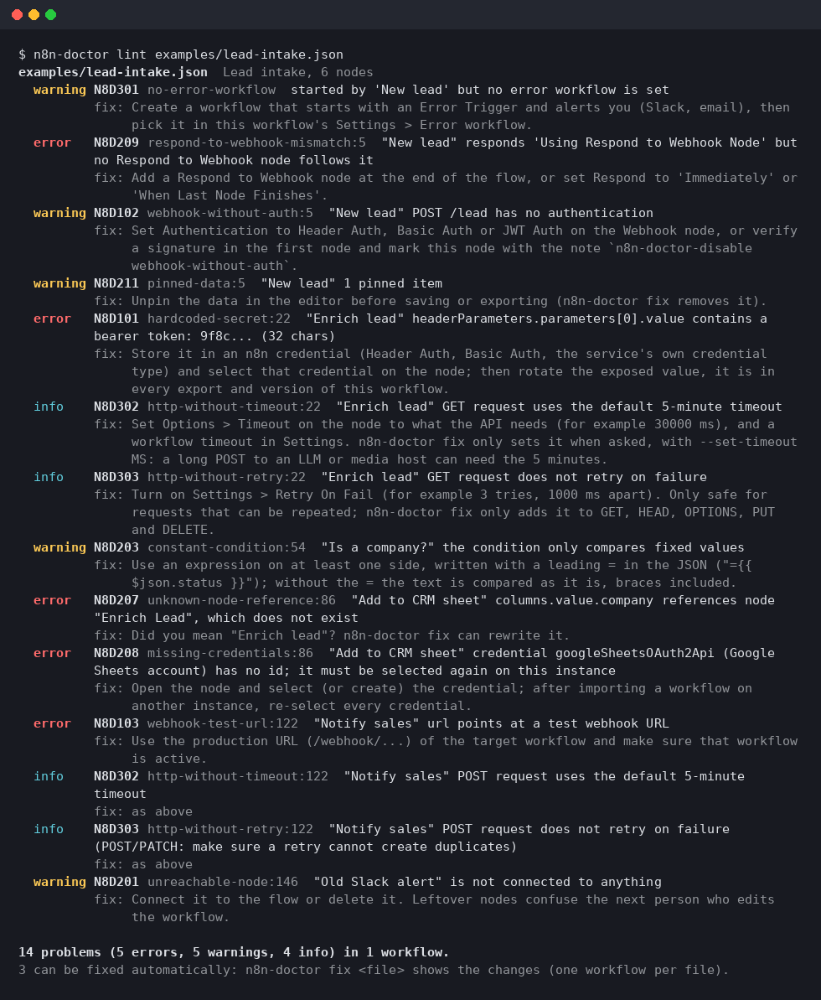
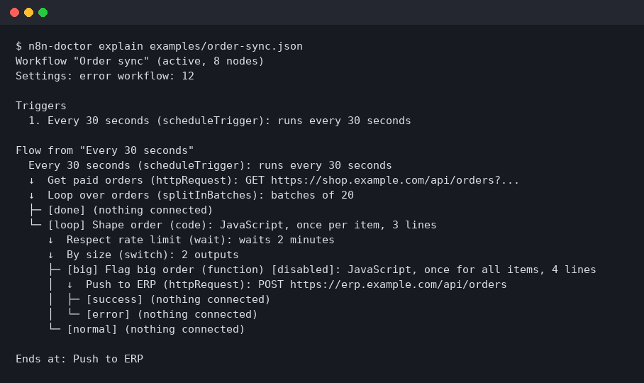

<h1 align="center">n8n-doctor</h1>

<p align="center">
  <b>Find what will break in an n8n workflow before it runs in production.</b><br>
  A linter for exported workflow JSON with 33 rules, plus an outline of what a workflow does,<br>
  reviewable auto-fixes, and read-only triage of failed executions. CLI, GitHub Action, SARIF, agent skill and MCP server.
</p>

<p align="center">
  <a href="https://github.com/vladosskins178/n8n-doctor/actions/workflows/ci.yml"></a>
  <a href="LICENSE"></a>
  
  
  
</p>

<p align="center">
  
</p>

---

n8n workflows fail in ways the editor does not show: a webhook that anyone can call, a
token pasted into a header, an expression that still points at a node you renamed, a Loop
Over Items whose `done` branch never fires, a schedule that starts the next run before the
last one finished, a missing Respond to Webhook node that leaves the caller hanging. All of
these are visible in the workflow JSON. `n8n-doctor` reads that JSON and tells you, with
the node, a rule id and what to do about it.

| Command | What it does |
| --- | --- |
| `n8n-doctor lint` | Checks workflow files or folders against [33 rules](https://github.com/vladosskins178/n8n-doctor/blob/main/docs/rules.md): security, structure, reliability and Code node pitfalls. Text, JSON, SARIF or GitHub annotations; exit code for CI. |
| `n8n-doctor explain` | Outlines a workflow: triggers, the path items take through IF/Switch/loop branches, where it ends, and nodes that never run. Also as a Mermaid chart. |
| `n8n-doctor fix` | Lists the fixes for the auto-fixable findings, value by value (only the changed token, never whole values). Writes nothing unless you add `--write`, and then only a new file. |
| `n8n-doctor executions` | Groups recent failed executions on your instance by workflow, node and error (read-only, n8n public API). |
| `n8n-doctor mcp` | The same as MCP tools, so an agent can check a workflow while it builds it. |

Everything works offline on exported JSON; no n8n instance is needed. It is pure Python
with no dependencies (Python 3.10 adds `tomli` for the config file).

## Quick start

```bash
pipx install "n8n-doctor @ git+https://github.com/vladosskins178/n8n-doctor"

n8n-doctor lint my-workflow.json                  # one export
n8n-doctor lint workflows/                        # a folder, e.g. a git-backed n8n repo

# everything on a self-hosted instance: one file per workflow
n8n export:workflow --backup --output=workflows/
n8n-doctor lint workflows/
```

One file per workflow is also what `fix` needs (it works on one workflow per file), and it
keeps each file small: a single `export:workflow --all` file of a large instance can pass the
20 MB file limit (raise it with `--max-file-mb`, up to 64).

Log lines before the JSON of a file or stdin (as `export:workflow --all` can print) are skipped by `lint`.
Besides single exports and `export:workflow --all` arrays, n8n-doctor reads API responses
(`{"data": [...]}`) and workflows downloaded from n8n.io templates (`{"id": ..., "workflow": {...}}`).

Try it on the broken examples in this repository:

```bash
git clone https://github.com/vladosskins178/n8n-doctor && cd n8n-doctor
python3 -m venv .venv && . .venv/bin/activate && pip install -e .
n8n-doctor lint examples/            # 23 problems in 3 workflows; healthy.json is clean
n8n-doctor explain examples/order-sync.json
n8n-doctor fix examples/lead-intake.json
```

To get a workflow's JSON out of the editor, select all nodes and copy (the clipboard holds
the JSON), or use *Download* in the workflow menu.

## What it checks

| Group | Rules |
| --- | --- |
| **Security** | hardcoded tokens, keys and passwords (provider formats, sensitive headers, URLs, Code nodes; values are masked in the output) · Webhook or public Chat Trigger without authentication · calls to `/webhook-test/` URLs · Wait node anyone can resume · "Ignore SSL Issues" |
| **Structure** | nodes no trigger reaches · workflows without a trigger · IF/Filter/Switch conditions that compare fixed values (the missing `=` before `{{ }}`) · Switch outputs that drop items · connections to missing nodes · duplicate node names · expressions and Code that refer to nodes that do not exist · missing credentials · Webhook / Respond to Webhook mismatches · disabled nodes mid-flow (they pass data through) · pinned data · expressions missing their leading `=` · entries of the nodes array that are not nodes · schedule, cron and Wait times n8n cannot use |
| **Reliability** | no error workflow on production triggers · HTTP Request without timeout or retry · Loop Over Items that only processes the first batch · cycles nothing can stop · schedules that overlap their own runs · Wait without a time limit · error outputs connected to nothing · Execute Workflow without a target · failed executions not saved |
| **Code** | deprecated Function nodes · legacy `$node[...]`, `$items()`, `items` · `$input.all()` or `items` in "Run Once for Each Item" mode |
| **Input** | parts of a workflow checked only in part because they are over a resource limit (N8D001, info) |

Each rule is documented with its reason and fix in [docs/rules.md](https://github.com/vladosskins178/n8n-doctor/blob/main/docs/rules.md);
`n8n-doctor rules` lists them. Reports, `explain` and the `fix` review mask the secrets
N8D101 finds; the fixed workflow itself (`--write`, the JSON Patch of `--include-patch`) is your file and keeps
them. The checks follow n8n's own node definitions and the
failures that keep coming back on the community forum. Rules only report what can be
decided from the JSON, so a clean run means "no known problems", not "correct".

## explain

<p align="center"></p>

Branches carry the names the editor uses (`[true]`/`[false]`, Switch output names,
`[done]`/`[loop]`, `[success]`/`[error]`), outputs that lead nowhere are shown, and cycles
are marked `back to ...`. `--format mermaid` prints a flowchart that GitHub renders in
Markdown; `--format json` gives the same structure to scripts.

## fix

Auto-fixes cover pinned data, expressions missing their `=`, retries (only for GET, HEAD, OPTIONS, PUT and
DELETE), connections to missing nodes, references to a node that was clearly renamed, and
the "do not save failed executions" setting. HTTP timeouts (N8D302) are reported but changed only with
`--set-timeout MS` (on the nodes without one, at most 2147483647), because a long POST to an LLM or media host can need n8n's 5-minute
default. A file holding `NaN`, `Infinity` or a number too large for JSON is listed but not written: correct it first. The default is a dry run. `--write` saves
`<name>.fixed.json` next to the input (or `-o PATH`) and refuses to overwrite the input, or
an existing file without `--force`, or anything but a regular file (a device, fifo, socket or folder, even with
`--force`). The output path is checked before anything is printed. A new file gets the permissions of the input
and a replaced one keeps its own, so the fixed copy of a `0600` file is not readable by others.

The output lists the changes, then each changed value with its node, parameter path and only
the changed token, never a whole parameter value:

```text
$ n8n-doctor fix examples/lead-intake.json
3 changes:
  - N8D211 removed pinned data (New lead)
  - N8D303 "Enrich lead": retry on fail, 3 tries, 1000 ms apart (GET)
  - N8D207 "Add to CRM sheet" columns.value.company: "Enrich Lead" -> "Enrich lead"

examples/lead-intake.json:
  pinData: removed 1 pinned record of 1 node
  "Enrich lead" retryOnFail: added true
  "Enrich lead" maxTries: added 3
  "Enrich lead" waitBetweenTries: added 1000
  "Add to CRM sheet" columns.value.company: "$('Enrich Lead')" -> "$('Enrich lead')"
```

Every field shows the changed token alone, never the text around it. A value replaced as a
whole shows `<value changed, N chars>`, unless it is at most 40 characters, holds no secret
and is not a code, request, template or secret-named field (`jsCode`, `body`, `jsonOutput`,
`query`, `html`, `url`, headers, anything named for a secret): then old -> new, masked. `--format json` returns the same as
`changes` and `edits` (node, path, before, after); `--include-patch` adds `patch`, the raw
RFC 6902 JSON Patch, which like `--write` is a copy of your file, secrets included (not
log-safe).
Secrets are never auto-fixed: they need a credential and a rotation.

## Configuration

`.n8n-doctor.toml` (or `[tool.n8n-doctor]` in `pyproject.toml`), found by walking up from
the checked path to the repository root:

```toml
disable = ["N8D303"]                  # rule ids or names
fail-on = "warning"                   # error (default), warning, info or never
exclude = ["drafts/**", "*.backup.json"]   # a file named on the command line is not checked either, and lint says so

[severity]
http-without-timeout = "warning"

[rules.hardcoded-secret]
allow = ["^pk_test_"]                 # regexes for values that are not secrets
```

Inside folders, `*.fixed.json` files (the copies `fix --write` saves) are skipped; name one
explicitly to check it. `allow` patterns are limited to 200 characters and only tried on
values up to 1024 characters.

To accept a finding on one node, write `n8n-doctor-disable webhook-without-auth` (a rule
name or id, or nothing to silence every rule except secrets and open webhooks) in the
node's **Notes**. In a **sticky note** it applies to the whole workflow. Both live in the
workflow, so the reason travels with it. Suppressed findings are still counted in every
report, and `--no-inline-suppress` ignores the notes when you check someone else's
workflow (a template, a pull request).

Options: `--select`, `--ignore`, `--fail-on`, `--min-severity`, `--format`, `--output`,
`--config`, `--no-config`, `--no-inline-suppress`, `--verbose`, and the resource limits below.
Exit codes: `0` no findings at or above `--fail-on`, `1` findings, `2` usage, input or API
error (an input over a resource limit included, and an `--output` that cannot be written:
`--output` never creates folders, a missing folder is an error, and it only replaces regular
files: a device, fifo, socket or folder, a symlink to one, or a symlink into `/proc` or `/dev`
(such as `/dev/stdout`) is refused and left in place, never written through, and so is any other path directly in
`/dev`, such as the typo `/dev/nul`; use `-o -` for stdout). An existing file is replaced only if
it is an earlier report of `n8n-doctor` (JSON or SARIF that parses as one; a text or GitHub report written with `-o`
starts with the line `n8n-doctor report (a later lint -o may replace this file)`), or with `--force`; what the run reads is never replaced, `--force` or not:
a file it was given, the file stdin reads, the config file, any other JSON file of a folder it
scans. A replaced file keeps its permissions.

In a folder, a file that cannot be checked (broken JSON from a bad merge, or over a resource
limit) does not stop the run: the other files are checked and reported, the file is listed
as not checked (in the text report, under `errors` in JSON, as an error annotation with
`--format github`, and as a tool execution notification in SARIF), and the exit code is `2`.
JSON files in a folder that are not workflows (`package.json`) are skipped, not errors.

### Resource limits

Real workflows have tens to a few hundred nodes. To keep the work per file bounded on
crafted or broken input, every file is checked once, when it is loaded, against limits on
its size and shape, so every rule and every output works on bounded data. Each limit can be
changed in a `[limits]` table of the config file, and on the command line of the commands
that use it (the command line wins).

| Limit | Default | Flag / `[limits]` key | Past the limit |
| --- | --- | --- | --- |
| File size (also stdin and the MCP `workflow` argument) | 20 MB | `--max-file-mb` / `max-file-mb` (at most 64) | error, exit code 2 |
| Workflows in one file (an `export:workflow --all` array) | 1,000 | `--max-workflows-per-file` / `max-workflows-per-file` | error, exit code 2 |
| Nesting of JSON arrays and objects | 64 levels | `--max-depth` / `max-depth` (8 to 512) | error, exit code 2 |
| Nodes per workflow | 5,000 | `--max-nodes` / `max-nodes` | error, exit code 2 |
| Nodes plus workflows in one file, embedded workflows included | 50,000 | `--max-file-nodes` / `max-file-nodes` | the file's own workflows over it: error, exit code 2; an embedded workflow past it is scanned as text instead of read as a workflow, and an `info` finding (N8D101) says so |
| Connections per workflow, and connection output lists | 50,000 | `--max-connections` / `max-connections` | error, exit code 2 |
| Outputs of one node (output lists in its connections, Switch rules) | 1,000 | `--max-outputs` / `max-outputs` | error, exit code 2 |
| Connections from one output | 1,000 | `--max-targets-per-output` / `max-targets-per-output` | error, exit code 2 |
| A node or workflow name, node type, workflow id, or name in connections and pinned data | 1,024 characters | `--max-name-length` / `max-name-length` | error, exit code 2 |
| Values in all node parameters of a workflow (strings, numbers, objects, arrays) | 200,000 | `--max-parameter-values` / `max-parameter-values` | error, exit code 2 |
| Entries of one array in node parameters | 10,000 | `--max-list-length` / `max-list-length` | error, exit code 2 |
| Path of a value in node parameters (`options.headers[0].value`) | 1,024 characters | `--max-path-length` / `max-path-length` | error, exit code 2 |
| Distinct secrets in a workflow's parameters | 50,000 | `--max-secrets` / `max-secrets` | error, exit code 2 |
| Their total length (every spelling that is masked) | 2 MB | `--max-secret-kb` / `max-secret-kb` | error, exit code 2 |
| One value or name checked for secrets | 256 KB | `--max-value-kb` / `max-value-kb` | its first and last 128 KB are checked; an `info` finding (N8D101) says so, and `explain`/`fix` show the value as `<N characters, too large to check for secrets: not shown>` |
| Embedded text that does not parse, read as raw text per file (every level of escapes counts) | 8 MB | `--max-raw-scan-mb` / `max-raw-scan-mb` | the rest is not scanned; an `info` finding (N8D101) says so, and `explain` does not show the embedded fields of that file |
| Code node source analysed for references, legacy syntax and the Code mode | 1 MB | `--max-code-kb` / `max-code-kb` | the first 1 MB is analysed; an `info` finding (N8D001) says so |
| Findings per rule and workflow (`lint`) | 200 | `--max-findings-per-rule` / `max-findings-per-rule` | one summary finding (`N more findings of ... not listed`), listed after the others |
| Findings per workflow, all rules together (`lint`) | 5,000 | `--max-findings` / `max-findings` | one N8D001 summary finding, listed last; for both summaries, totals and the exit code still include every finding, and the fixable count every finding but the counted N8D207 ones (typo suggestions are worked out for listed findings only) |
| Findings in the whole run, all workflows together (`lint`) | 20,000 | `--max-findings-total` / `max-findings-total` | one N8D001 summary finding for the run, listed last, with the counts left out by severity and by rule (in JSON `summary.not_listed` and `omitted_by_rule`; in SARIF a warning notification and `runs[0].properties.omittedFindings`); totals and the exit code still include every finding (the fixable count as above) |
| `explain` tree depth | 50 levels | `--max-explain-depth` / `max-explain-depth` | deeper branches continue at that indentation after a `↳ (depth limit ...)` line |
| `explain` text and Mermaid output, per run (all workflows of a file together) | 2 MB | `--max-output-kb` / `max-output-kb` | output ends with `... truncated` and a count of the workflows not shown |
| Workflow JSON `executions` reads per run to mask workflow secrets in error messages | 16 MB | `--max-masker-mb` / `max-masker-mb` | the error messages and workflow and node names of the remaining executions are hidden (workflow id, node position and type, error class, counts and times stay); a note on stderr says so |

```toml
[limits]
max-nodes = 20000
max-file-mb = 40
```

The `lint` limits on findings apply after `--min-severity`, so the counts of findings that
are not listed match the filter. `fix` fixes every finding, not only those `lint` lists.
An input over a hard limit is an error even inside a folder, so a CI run cannot pass by
skipping it (the other files are still checked). Under the default limits `lint`, `explain` and `fix` took up to 22 seconds and
550 MB on the crafted files in the table in SECURITY.md; that is what was measured, not a limit, and slower crafted files exist (33 seconds on one with 49,000 distinct secrets). These include a file of 1,000 workflows of 48 nodes with 193,000 findings, 5 million empty nodes in one embedded text, and a million references to one misspelled node in a Code node. JSON and
SARIF reports are written one finding at a time, so raising `--max-findings-total` costs time but little memory. The
measurements are in [SECURITY.md](SECURITY.md). The MCP tools use the config file next to a
`path`, and the defaults for an inline `workflow`.

## In CI

The repository is also a GitHub Action. It annotates the pull request diff and fails the
job on errors:

```yaml
- uses: actions/checkout@v4
- uses: vladosskins178/n8n-doctor@v0
  with:
    path: workflows/
    args: --fail-on warning           # optional
```

`path` takes the files and folders to check (separated by spaces, quotes respected; they
are passed after `--`, so a name that starts with `-` is still a path). Glob patterns such as
`workflows/**/*.json` are expanded by the action itself, without a shell; a path that exists
as written is taken as it is, and a pattern that matches nothing is passed on (and reported as
missing). `*` stays inside one folder name, `**` is any number of folders (none included), and a
pattern ending in `/` (`workflows/**/`) matches folders only. Patterns match hidden files and
folders (`.name`), skip symlinks (to files and to folders) as a folder scan does, and never match
anything inside the folders a folder scan skips (`.git`, `node_modules`, `.venv`, ...). More than
10,000 paths in all stop the action with an error. Paths are compared after removing `.` parts
and doubled slashes, so `./workflows/a.json` and `workflows/a.json` are checked once. `args` takes
options only: a path in `args` stops the action with an error, since it would be checked in
addition to `path`, and so do `-h`, `--help` and `--version`, which would print text instead of
checking, and `--format` and `--output`, which the action sets itself. The boolean inputs (`annotations`, `upload-sarif`,
`inline-suppressions`) are all read the same way, ignoring case and spaces: `true`, `yes`,
`on` or `1` turn one on, `false`, `no`, `off` or `0` turn it off. The folder of `sarif-file`
is created if needed.

On pull requests that may come from people you do not control (forks, or any
`pull_request_target` job that checks out the pull request), the pull request also
controls the workflows' notes and the config files in its checkout. Add
`inline-suppressions: "false"` so notes inside the changed workflows cannot silence
findings, and `config: none` (or `config:` pointing at a file checked out from the base
branch) so an added `.n8n-doctor.toml` cannot disable rules or allow its own secrets:

```yaml
- uses: vladosskins178/n8n-doctor@v0
  with:
    path: workflows/
    inline-suppressions: "false"
    config: none
```

For GitHub code scanning add `sarif-file: n8n-doctor.sarif` and `upload-sarif: "true"`
(the job needs `permissions: security-events: write`). Without the action:

```bash
n8n-doctor lint workflows/ --format sarif --output n8n-doctor.sarif
n8n-doctor lint workflows/ --format github     # annotations from any GitHub Actions step
```

## Live instance (read-only)

```bash
export N8N_API_URL=https://n8n.example.com
export N8N_API_KEY=...                 # n8n: Settings > n8n API
n8n-doctor executions                  # the last 100 failed executions, grouped
n8n-doctor executions --workflow-id 42 --limit 500 --format json
n8n-doctor lint --api --active-only    # lint what is actually deployed
n8n-doctor explain --api --workflow-id 42
```

`lint --api` reads up to 1,000 workflows. If the instance has more, the report covers the
first 1,000 and the run fails (exit code `2`) with a warning; `--max-workflows N` reads up
to N instead, and then hitting N is only a warning.

The output looks like this:

```
14 error executions, 3 distinct problems

   9x  Order sync > Push to ERP
       Request failed with status code 429
       executions 9812, 9809, 9790, 9771, 9768 ...; 2026-11-01T08:00:12Z .. 2026-11-04T07:30:05Z
```

Only `GET` requests are made; nothing on the instance changes. The key is read from the
environment, sent only to `N8N_API_URL` (redirects are refused so it cannot be forwarded),
and never printed: a message or name that repeats it (in any letter case, URL-encoded, or
inside base64 such as a Basic auth header) shows `***`. All the API calls of one command
stop after `--timeout` seconds in all (default 300; the MCP server uses 300). When the time runs
out after some executions were read, `executions` still prints what it grouped so far, ends the
report with `Incomplete: stopped after N executions: ...` (`"incomplete"` in JSON), warns on stderr
and exits with code `3`; if nothing was read yet, it is an API error (exit code `2`). Executions are
read 10 per page with their run data, and a page over 16 MB is read again in smaller pages (an
execution over 16 MB on its own is grouped without its error details), so a run with huge run data
stays at a few hundred MB of memory. Messages are grouped after ids, timestamps and long numbers are
normalised, so the same failure on different records lands in one group.

Error messages are masked with the secrets of their own workflow (a header value, say) as
well as the secret patterns. When that is not possible, because the run already read
`--max-masker-mb` of workflow JSON (default 16) or the workflow could not be read, the
message is hidden and replaced by `message hidden (workflow secrets could not be checked; ...)`.
Workflow and node names are hidden as well, since a name can repeat such a secret: the group
shows `workflow 123 > node #4 (httpRequest)` (the workflow id, the node's position in the
workflow's `nodes` array and its type). The error class (only a name such as `NodeApiError`;
anything else shows as `Error`), counts and times are still shown, and JSON marks the group
with `"message_hidden": true` and `"names_hidden": true`. Raise `--max-masker-mb` or read fewer executions (`--limit`,
`--workflow-id`) to see them. `--pattern-masking-only` shows such messages masked by the
patterns only instead: **less safe**, since a secret that exists only in the workflow can
then appear.

## Use it from an agent

**Claude Code** (plugin with the skill):

```text
/plugin marketplace add vladosskins178/n8n-doctor
/plugin install n8n-doctor@n8n-doctor
```

The plugin also registers the MCP server (started with `uvx`, so [uv](https://docs.astral.sh/uv/)
must be installed). Or copy only the skill: `n8n-doctor skill install` writes
`~/.claude/skills/n8n-doctor/SKILL.md`. For Codex, Cursor, Gemini CLI and others:
`n8n-doctor skill print >> AGENTS.md`. The skill teaches the lint, fix and explain loop and
the n8n conventions that keep generated workflows passing (expressions need `=`, Loop Over
Items wiring, Code node modes, credentials instead of literal tokens).

**MCP**: `n8n-doctor mcp` serves `n8n_lint`, `n8n_explain`, `n8n_fix` and
`n8n_executions` over stdio. The first three take a file path or the workflow JSON itself,
so an agent can check a workflow before it ever reaches n8n. `n8n_fix` returns the changes and
each changed value with only the changed token, secrets masked (`output: "patch"` or
`"workflow"` returns the raw JSON Patch or fixed workflow, secrets included) and never writes. Paths are limited to the server's working directory (set
`N8N_DOCTOR_MCP_ROOTS` to a list of folders, separated like `PATH`, to allow others).

```bash
claude mcp add n8n-doctor -- n8n-doctor mcp
claude mcp add n8n-doctor -e N8N_API_URL=https://n8n.example.com -e N8N_API_KEY=... -- n8n-doctor mcp
```

```json
{ "mcpServers": { "n8n-doctor": { "command": "/absolute/path/to/n8n-doctor", "args": ["mcp"] } } }
```

Desktop clients often start servers without your shell's `PATH`, so use the absolute path
from `which n8n-doctor` there.

## How it fits with other n8n tools

[n8n-mcp](https://github.com/czlonkowski/n8n-mcp) gives an agent a database of n8n node
documentation and properties and can validate node configurations against it while the
agent builds a workflow, and create or update workflows on an instance. n8n-doctor is
narrower and works after the fact, without node data or an instance: it reads finished
workflow JSON and looks for the problems that make a valid-looking workflow fail or leak
in production (secrets, open webhooks, loops, overlaps, stale references), with stable
rule ids, SARIF and exit codes for CI, and read-only execution triage. The two work fine
side by side.

## Limits

- Rules are static: they see the workflow, not the data. An expression that is valid but
  reads the wrong field is out of reach.
- Node knowledge covers n8n 1.x core nodes (IF v1/v2, Switch v1 to v3, Loop Over Items v3,
  HTTP Request v3/v4, Code v2, Wait v1.1). Community nodes get the generic rules only.
- `explain` follows main connections; AI sub-nodes are listed with the agent they serve.
- Secret detection uses known formats and parameter names. A random string in an unusual
  parameter can slip through, so treat it as a net, not a guarantee.
- Inputs are bounded by the [resource limits](#resource-limits) (20 MB and 50,000 nodes plus
  workflows per file, 5,000 nodes and 50,000 connections per workflow by default). An
  `export:workflow --all` of more than 50,000 nodes needs `--max-file-nodes` raised.

## Uninstall

```bash
pipx uninstall n8n-doctor
claude plugin uninstall n8n-doctor@n8n-doctor      # if you installed the plugin
claude mcp remove n8n-doctor                       # if you added the MCP server by hand
rm -r ~/.claude/skills/n8n-doctor                  # if you used `skill install`
```

## Contributing

Issues and pull requests are welcome; see [CONTRIBUTING.md](https://github.com/vladosskins178/n8n-doctor/blob/main/CONTRIBUTING.md). A workflow
JSON that produces a false positive (secrets removed) is the most useful bug report.

## License

[MIT](https://github.com/vladosskins178/n8n-doctor/blob/main/LICENSE)
